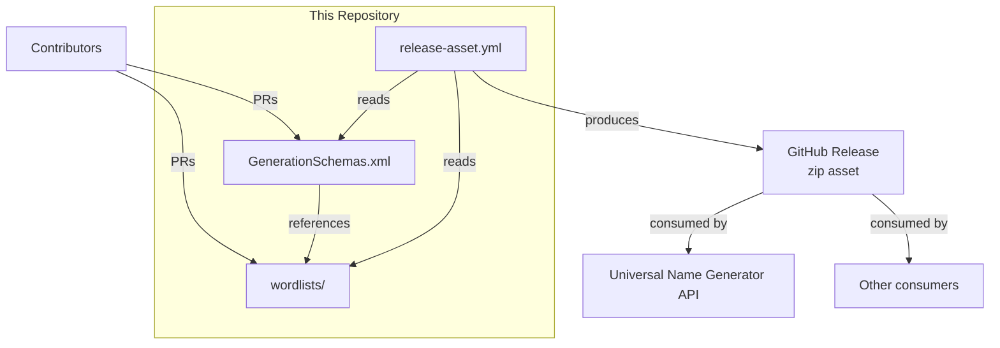

# Universal Name Generator — Wordlists Architecture

This document describes the current architecture of the Universal Name Generator — Wordlists repository. It covers the repository's role as a curated data-asset collection, its schema validation layer, distribution model, and the boundaries that separate it from downstream consumers such as the Universal Name Generator API.

## 📑 Table of Contents

- [Purpose](#purpose)
- [System Context](#system-context)
- [Architectural Style](#architectural-style)
- [Runtime Flow](#runtime-flow)
- [Architectural Areas](#architectural-areas)
- [Data Architecture](#data-architecture)
- [Interfaces and Integrations](#interfaces-and-integrations)
- [Dependency Direction and Rules](#dependency-direction-and-rules)
- [External Dependencies](#external-dependencies)
- [Deployment and Operations](#deployment-and-operations)
- [Compatibility Contracts](#compatibility-contracts)
- [Testing and Verification](#testing-and-verification)
- [Design Constraints](#design-constraints)
- [Extension Points](#extension-points)
- [Source Map](#source-map)
- [Related Documentation](#related-documentation)

## 🎯 Purpose

This repository provides curated wordlist assets and generation schemas for name generation. Its principal responsibility is to supply well-structured, versioned datasets that downstream generators consume at build or runtime. The intended audience includes maintainers of the Universal Name Generator API, contributors adding new datasets, and integrators who validate schema compliance. Recording these boundaries clarifies that this repository owns data and schema definitions only; it does not own generator logic, runtime execution, or API behaviour.

## 🌐 System Context

```mermaid
flowchart LR
    subgraph "Universal Name Generator — Wordlists"
        direction TB
        Datasets[(wordlists/)]
        Schemas[(GenerationSchemas.xml)]
        Release[GitHub Releases\n(zip archives)]
    end

    Contributors[Contributors] -->|PRs: new .lst files,\nschema entries| Datasets
    Contributors -->|PRs: schema updates| Schemas
    CI[GitHub Actions\nrelease-asset.yml] -->|packages| Release
    Datasets -->|validated against| Schemas
    Schemas -->|validated by| CI

    Release -->|consumed by| APIGen[Universal Name Generator API]
    Release -->|consumed by| OtherConsumers[Other downstream\ngenerators or tools]
```

The principal external boundaries are:
- **Contributors:** Submit new wordlist files (`.lst`) and schema entries (`GenerationSchemaDataObject`) via pull requests. Ownership of accepted contributions transfers to the repository.
- **GitHub Actions (release-asset.yml):** Validates schema compliance, packages `wordlists/` and `GenerationSchemas.xml` into versioned zip archives, and publishes them to GitHub Releases.
- **Universal Name Generator API (downstream consumer):** Consumes release archives at build time to embed datasets into its generator. The API repository is the primary consumer; other tools may also consume releases.
- **Other downstream generators or tools:** Any third-party consumer of the release archives. No compatibility guarantees beyond the documented contracts.

## 🏗️ Architectural Style

**Data-asset repository with schema validation and versioned distribution.**

This repository implements a curated-asset pattern: the authoritative artefacts are plain-text datasets (`.lst` files) and an XML schema catalogue (`GenerationSchemas.xml`). A CI pipeline validates every contribution against the schema, then packages the complete asset tree into immutable versioned archives published to GitHub Releases. The principal consequences are:
- **Ownership:** This repository owns data curation, schema evolution, and release packaging. It does not own generator implementation, runtime, or API contracts.
- **Change propagation:** Schema changes are breaking for downstream consumers unless the schema versioning policy is followed. Data additions are non-breaking.
- **Verification:** Schema validation is the primary automated gate; there are no runtime tests because there is no runtime.

## 🔄 Runtime Flow

This repository has no runtime execution. The principal automated flow is the release packaging pipeline:

```mermaid
flowchart TD
    A[Release published\n(tag vX.Y.Z)] --> B[GitHub Actions\nrelease-asset.yml]
    B --> C[Checkout repository]
    C --> D[Validate schema\n(xmllint if configured)]
    D --> E[Package wordlists/\nand GenerationSchemas.xml\ninto zip]
    E --> F[Upload asset to\nGitHub Release]
    F --> G[Release archive\navailable for download]
```

The principal runtime sequence is:
1. Maintainer creates a Git tag and GitHub Release (e.g., `v3.2.0`).
2. `release-asset.yml` workflow triggers on `release.published`.
3. Workflow checks out the repository at the release tag.
4. Workflow packages `wordlists/` and `GenerationSchemas.xml` into `universal-name-generator-wordlists_<version>.zip`.
5. Workflow uploads the zip as a release asset.
6. Downstream consumers (primarily the Universal Name Generator API) download the archive at build time.

## 🗂️ Architectural Areas

### Wordlist Datasets

Paths:
- `wordlists/`

Responsibilities:
- Provide curated naming datasets organised by universe (e.g., `age-of-wonders`, `elder-scrolls`, `real`) and category (e.g., `persons/males`, `locations/cities`, `units`).
- Each `.lst` file contains one candidate value per line (full names or word fragments).
- Preserve setting-specific naming identity; no forced homogenisation.

Boundary rules:
- New universes or categories added under `wordlists/` with lowercase, hyphen-separated directory names.
- `.lst` files must be UTF-8, one entry per line, no trailing whitespace.
- Contributors must not modify generator logic or introduce code files.

### Generation Schemas

Paths:
- `GenerationSchemas.xml`

Responsibilities:
- Define generation structures (`GenerationSchemaDataObject`) that map logical generators to concrete `.lst` file paths.
- Each schema entry specifies an `Id`, `Name`, `Category`, and a `Schema` string encoding the generation algorithm (e.g., `{randomiser, ,4,32,real/arabic/persons/males|real/arabic/persons/surnames}`) and source file references.
- Serve as the contract between this repository and downstream consumers.

Boundary rules:
- Schema `Id` values must be unique and stable; changing an `Id` is a breaking change for consumers.
- Schema `Schema` strings reference repository-relative paths under `wordlists/`; path changes require coordinated schema updates.
- Only maintainers may modify the XML structure; contributors may propose new `GenerationSchemaDataObject` entries.

### Release Packaging

Paths:
- `.github/workflows/release-asset.yml`

Responsibilities:
- Automate packaging of `wordlists/` and `GenerationSchemas.xml` into versioned zip archives.
- Publish archives as GitHub Release assets.
- Ensure the archive structure matches consumer expectations (root contains `wordlists/` and `GenerationSchemas.xml`).

Boundary rules:
- Workflow triggers only on `release.published` events.
- Archive naming convention: `universal-name-generator-wordlists_<version>.zip` (version without `v` prefix).
- No additional artefacts or metadata included in the archive.

### Repository Metadata

Paths:
- `.github/FUNDING.yml`
- `.github/workflows/`
- `README.md`, `CONTRIBUTING.md`, `CODE_OF_CONDUCT.md`, `SECURITY.md`, `PRIVACY.md`, `ROADMAP.md`, `LICENSE`

Responsibilities:
- Govern contribution workflow, funding, security reporting, conduct, privacy, roadmap, and licensing.
- Provide human-readable navigation and policy documentation.

Boundary rules:
- Documentation files reside at repository root; no `docs/` directory.
- Policy changes follow standard pull-request review.

## 💾 Data Architecture

```mermaid
flowchart LR
    subgraph "Repository"
        LST[.lst files\n(wordlists/)]
        XML[GenerationSchemas.xml]
    end

    LST -->|referenced by| XML
    XML -->|validated by| CI[GitHub Actions]
    LST -->|packaged with| XML
    XML -->|packaged with| LST
    CI -->|produces| Archive[Release zip\n(wordlists/ + GenerationSchemas.xml)]
    Archive -->|downloaded by| Consumer[Downstream generator\n(e.g., Universal Name Generator API)]
    Consumer -->|embeds at build| Runtime[Generator runtime]
```

| Data or Store | Owner | Representation and Storage | Lifecycle or Consistency |
|---------------|-------|----------------------------|--------------------------|
| `wordlists/` (`.lst` files) | Repository maintainers | Plain text, UTF-8, one entry per line, newline-delimited | Append-only by default; entries added via PR. No deletion policy; duplicates flagged but not auto-removed. |
| `GenerationSchemas.xml` | Repository maintainers | XML (`ArrayOfGenerationSchemaDataObject` containing `GenerationSchemaDataObject` elements) | Schema entries added via PR. `Id` stability required. XML structure changes are breaking. |
| Release zip archives | GitHub Releases (via `release-asset.yml`) | Zip containing `wordlists/` and `GenerationSchemas.xml` at root | Immutable once published. Versioned by Git tag. Consumers pin to specific release versions. |

## 🔌 Interfaces and Integrations

| Interface or Integration | Direction | Contract | Owner | Failure Semantics |
|--------------------------|-----------|----------|-------|-------------------|
| `GenerationSchemas.xml` (schema catalogue) | Outbound (consumed by downstream) | XML schema: `ArrayOfGenerationSchemaDataObject` / `GenerationSchemaDataObject` with `Id`, `Name`, `Category`, `Schema` | Repository maintainers | Downstream build fails if `Id` missing, `Schema` references non-existent `.lst` path, or XML malformed. |
| `.lst` file format | Outbound (consumed by downstream) | Plain text, UTF-8, one entry per line, no trailing whitespace | Repository maintainers | Downstream generator produces empty or malformed output if lines missing, encoding wrong, or whitespace present. |
| Release zip archive layout | Outbound (consumed by downstream) | Zip root contains `wordlists/` and `GenerationSchemas.xml` | `release-asset.yml` workflow | Downstream build fails if archive structure differs (e.g., nested folder, missing files). |
| GitHub Releases | Outbound (distribution channel) | Published releases with assets; tag format `vX.Y.Z` | Repository maintainers | Consumers cannot fetch assets if release unpublished, asset missing, or tag format changed. |
| GitHub Actions (`release-asset.yml`) | Internal (CI) | Workflow triggered on `release.published`; packages and uploads asset | Repository maintainers | Release asset not produced; manual intervention required. |
| Contributor PRs | Inbound (data/schema contributions) | `.lst` files under `wordlists/`; `GenerationSchemaDataObject` entries in `GenerationSchemas.xml` | Contributors / maintainers (review) | Invalid PRs rejected in review; schema validation in CI catches structural errors. |

## 🧭 Dependency Direction and Rules



The principal dependency rules are:
- **Schemas depend on Datasets:** `GenerationSchemas.xml` `Schema` strings reference repository-relative paths under `wordlists/`. Dataset path changes require coordinated schema updates.
- **CI depends on Schemas and Datasets:** `release-asset.yml` packages both; schema validation (if enabled) reads both.
- **Downstream consumers depend on Release archives:** The Universal Name Generator API and other tools consume the published zip. They do not depend on the repository directly at runtime.
- **No reverse dependencies:** This repository does not depend on downstream consumers, generator logic, or API contracts.
- **Prohibited coupling:** Contributors must not introduce code files, build scripts, or runtime dependencies. The repository remains assets-only.

## 📦 External Dependencies

| Dependency | Responsibility | Integration Boundary | Architectural Consequence |
|------------|----------------|----------------------|---------------------------|
| `GitHub Actions` (ubuntu-latest runner) | CI execution environment | `.github/workflows/release-asset.yml` runs on GitHub-hosted runners | CI availability tied to GitHub platform; no self-hosted runner requirement. |
| `xmllint` (libxml2) | Optional XML schema validation | Referenced in CONTRIBUTING.md as `xmllint --schema GenerationSchemas.xml wordlists/**/*.lst` | Not enforced in CI currently; validation is advisory. If enforced, becomes a required CI dependency. |
| `zip` (Info-ZIP) | Archive packaging | `release-asset.yml` uses `zip -r` to create release archive | Standard Ubuntu package; no version pinning. |
| `softprops/action-gh-release@v2` | GitHub Release asset upload | `release-asset.yml` uses this action to upload the zip | Third-party action; pinned to v2. Updates may change behaviour. |

## 🚀 Deployment and Operations

| Concern | Current Design | Architectural Consequence |
|---------|----------------|---------------------------|
| Process topology | No runtime process. Static assets packaged by CI and published to GitHub Releases. | Zero operational overhead. No servers, containers, or services to manage. |
| Deployment model | Git tag + GitHub Release triggers `release-asset.yml`; asset uploaded automatically. | Deployment is a maintainer action (create release). No separate deploy pipeline. |
| Persistent state | Repository Git history (datasets, schemas, docs). Release archives immutable on GitHub. | State is Git + GitHub Releases. No external database or object store. |
| Filesystem or network requirements | None for the repository itself. Consumers download release archives via HTTPS. | No firewall, VPN, or storage provisioning needed. |
| Scaling assumptions | Archive size grows with dataset count. Current ~50 KB XML + ~100+ MB wordlists. GitHub Release asset limit (2 GB) not approached. | No scaling engineering required. If asset size becomes an issue, splitting by universe is an option. |
| Startup and shutdown responsibilities | N/A (no runtime). | N/A. |
| Operator-visible outputs | GitHub Release page with downloadable zip. CI workflow run logs. | Operators (maintainers) verify release asset presence and CI success. |

## 🛡️ Compatibility Contracts

| Contract | Owner | Invariant | Verification | Change Policy |
|----------|-------|-----------|--------------|---------------|
| `.lst` file format | Repository maintainers | UTF-8, one entry per line, no trailing whitespace, newline-delimited | Manual review; `git diff --check` catches whitespace | Non-breaking: additions only. Format changes require consumer coordination. |
| `GenerationSchemas.xml` structure | Repository maintainers | `ArrayOfGenerationSchemaDataObject` root; each `GenerationSchemaDataObject` has `Id`, `Name`, `Category`, `Schema` | XML well-formedness; optional `xmllint` validation | Breaking: `Id` rename/removal, `Schema` path changes, element removal. Non-breaking: new `GenerationSchemaDataObject` entries. |
| Release zip archive layout | `release-asset.yml` workflow | Zip root contains `wordlists/` and `GenerationSchemas.xml` | CI workflow success; manual inspection of asset | Breaking: layout change. Requires consumer migration. |
| Git tag / release version format | Repository maintainers | Tags `vX.Y.Z` (SemVer); archive name `universal-name-generator-wordlists_<X.Y.Z>.zip` | Release creation; workflow string manipulation | Breaking: tag format change breaks workflow version extraction. |

## ✅ Testing and Verification

This repository has no automated test suite. Verification is performed through:

- **Schema validation (advisory):** Contributors may run `xmllint --schema GenerationSchemas.xml wordlists/**/*.lst` locally to validate XML structure and `.lst` path references. Not currently enforced in CI.
- **Whitespace and formatting:** `git diff --check` before commit detects trailing whitespace and non-ASCII issues.
- **Duplicate detection:** No automated duplicate detection; ROADMAP.md identifies this as planned labour.
- **Release packaging verification:** Maintainers verify the release asset exists and contains the expected directory structure after `release-asset.yml` completes.

Execute the principal manual verification with:

```bash
# Validate XML well-formedness
xmllint --noout GenerationSchemas.xml

# Check .lst formatting (no trailing whitespace, UTF-8)
git diff --check

# Inspect release asset structure (after release)
# Download and unzip to verify wordlists/ and GenerationSchemas.xml at root
```

## ⚠️ Design Constraints

- **Assets-only repository:** No application code, build scripts, runtime, or executable artefacts are included. This constraint is deliberate to keep the repository focused on data curation and to avoid coupling to any specific generator implementation.
- **Diverse source fidelity:** Wordlists originate from varied sources (real-world languages, fictional settings, game data, community scrapes). Quality, style, and completeness vary intentionally; forced homogenisation is out of scope (per ROADMAP.md).
- **Schema stability:** `GenerationSchemaDataObject.Id` values are stable identifiers for downstream consumers. Changing an `Id` is a breaking change requiring consumer migration.
- **No runtime validation:** The repository does not execute generation logic. Schema correctness is structural only; semantic correctness (e.g., whether a schema produces desirable names) is not verified here.
- **Single distribution channel:** GitHub Releases is the only supported distribution. Unofficial mirrors, package managers, or container images are not maintained.
- **No dependency management:** The repository declares no runtime dependencies. Consumers are responsible for integrating the datasets into their own build/runtime environments.

## 🔧 Extension Points

### New Universe or Language Dataset

1. Create a new directory under `wordlists/` (e.g., `wordlists/new-universe/` or `wordlists/real/new-language/`) following lowercase, hyphen-separated naming.
2. Add `.lst` files organised by category (e.g., `persons/males.lst`, `locations/cities.lst`).
3. Ensure each `.lst` file is UTF-8, one entry per line, no trailing whitespace.
4. Add corresponding `GenerationSchemaDataObject` entries in `GenerationSchemas.xml` referencing the new `.lst` paths.
5. Submit via pull request for review.

Naming, lifetime, and compatibility conventions:
- Directory names: lowercase, hyphen-separated (e.g., `age-of-wonders`, `middle-earth`).
- Category subdirectories: plural nouns (e.g., `persons`, `locations`, `units`, `groups`).
- `.lst` filenames: descriptive, lowercase, hyphen-separated (e.g., `males.lst`, `surnames.lst`, `toponyms.lst`).
- Schema `Id` values: globally unique, kebab-case, prefixed by universe/category (e.g., `arabic-persons-male`, `asgarnian-persons-female`).
- Schema `Schema` strings: must reference repository-relative paths under `wordlists/`.

### New Generation Algorithm in Schema

1. Propose a new `Schema` string format in a `GenerationSchemaDataObject` entry.
2. Document the algorithm semantics in the PR description.
3. Ensure downstream consumers (especially the Universal Name Generator API) can parse the new format before merging.

## 🗺️ Source Map

| Area | Path |
|------|------|
| Wordlist datasets | `wordlists/` |
| Generation schemas | `GenerationSchemas.xml` |
| Release packaging workflow | `.github/workflows/release-asset.yml` |
| Funding configuration | `.github/FUNDING.yml` |
| Documentation (root) | `README.md`, `CONTRIBUTING.md`, `CODE_OF_CONDUCT.md`, `SECURITY.md`, `PRIVACY.md`, `ROADMAP.md`, `LICENSE` |

## 📚 Related Documentation

- [README.md](./README.md) — Project overview, capabilities, usage, and navigation.
- [CONTRIBUTING.md](./CONTRIBUTING.md) — Contribution guidelines, development setup, code style, testing.
- [CODE_OF_CONDUCT.md](./CODE_OF_CONDUCT.md) — Conduct expectations, reporting, enforcement.
- [SECURITY.md](./SECURITY.md) — Vulnerability reporting, supported versions, disclosure policy.
- [PRIVACY.md](./PRIVACY.md) — Data handling, storage, integrations, contact.
- [ROADMAP.md](./ROADMAP.md) — Current focus, planned labour, dependencies, out-of-scope items.
- [LICENSE](./LICENSE) — GNU General Public License v3.0 terms.